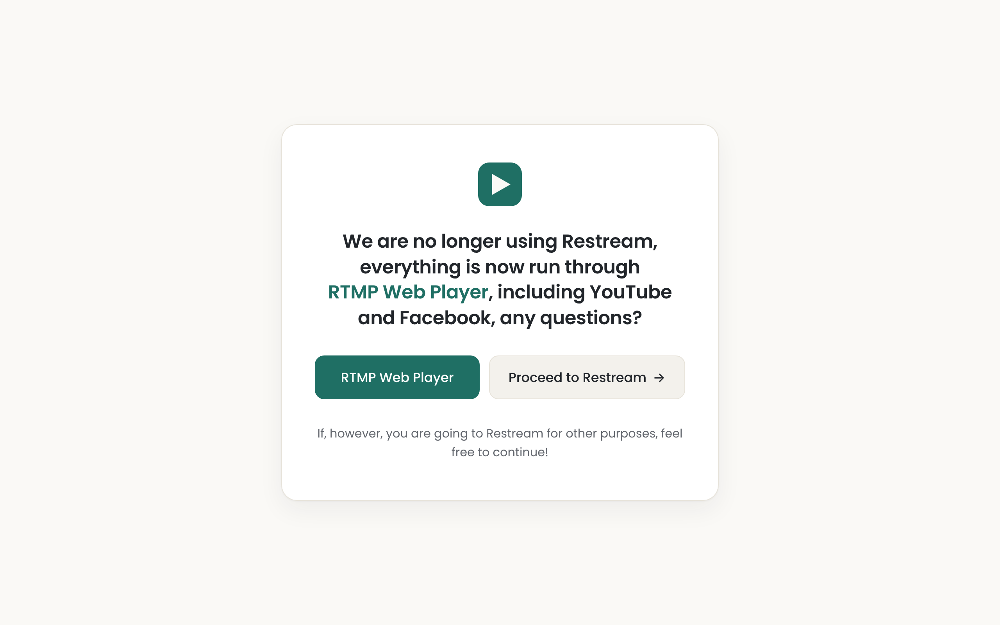

# RTMP Web Player Reminder

An unpacked Chrome / Edge extension (Manifest V3). When anyone visits `restream.io`
(or any subdomain, such as `app.restream.io` or `studio.restream.io`) it shows a notice
that Restream is no longer used and everything now runs through **RTMP Web Player**. The notice has a button
to <https://stream.rossmackenzie.co.uk> and a **Proceed to Restream** button.

## Install (unpacked)

**Chrome:** open `chrome://extensions`, turn on **Developer mode**, click **Load unpacked**
and pick the `extension` folder.

**Edge:** open `edge://extensions`, turn on **Developer mode**, click **Load unpacked**
and pick the `extension` folder.

## How it works

- A `declarativeNetRequest` rule redirects top-level visits to `*.restream.io` to
  `warning.html`, keeping the original address so Proceed can return to it.
- **Proceed** allows Restream in that tab for that one visit. Once the tab leaves
  Restream (or closes), the next visit shows the notice again.
- The Poppins font is bundled in `extension/fonts` (SIL Open Font License, see `OFL.txt`),
  so the page makes no requests to Google.
- Colours are CSS variables at the top of `extension/warning.css`.

## Publishing

See [`store/PUBLISHING.md`](store/PUBLISHING.md) for step-by-step instructions to publish
unlisted on the Chrome Web Store (which Edge can install from too), along with the listing text and images.
